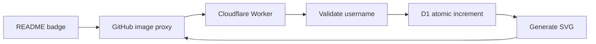

<div align="center">


<br>

[](LICENSE)
[](https://github.com/tashfiqul-islam/profile-view-counter/actions/workflows/ci.yml)
[](#tech-stack)
[](https://www.typescriptlang.org/)
[](https://hono.dev)

<br>

A **blazing-fast, edge-deployed** profile view counter for GitHub READMEs.

Built on **Cloudflare Workers** with **D1** for persistence and **Hono** for routing.

<br>

[](https://github.com/tashfiqul-islam/profile-view-counter)

_Click the badge above to see it in action_

</div>

---

## Quick Start

Add this to your GitHub profile `README.md`:

```markdown
[](https://github.com/tashfiqul-islam/profile-view-counter)
```

<details>
<summary>HTML alternative</summary>

```html
<a href="https://github.com/tashfiqul-islam/profile-view-counter">
  
</a>
```

</details>

> [!NOTE]
> Replace `YOUR_USERNAME` with your GitHub username.

---

## How It Works



Every time someone opens a README with the badge, GitHub's image proxy fetches it from the Worker. The badge is sent with `no-store`, so every view reaches the Worker: the username is lowercased (GitHub logins are case-insensitive), the count is atomically incremented in D1, and a fresh SVG is returned. `HEAD` requests from link checkers get the headers without being counted.

---

## Features

| Feature                  | Detail                                                                                                                                    |
| ------------------------ | ----------------------------------------------------------------------------------------------------------------------------------------- |
| **Edge-first**           | Global deployment with [Smart Placement](https://developers.cloudflare.com/workers/configuration/smart-placement/) for optimal D1 latency |
| **Atomic counting**      | `INSERT ON CONFLICT ... RETURNING` — zero race conditions                                                                                 |
| **Every view counts**    | `no-store` badge, case-insensitive usernames, `HEAD` not counted                                                                          |
| **Pristine at any size** | 28 px pill sized 1:1 to its `viewBox`; every text run pinned with `textLength`, so it never overflows and stays centred in any font       |
| **Accessible**           | WCAG: `role="img"`, `aria-labelledby`, `<title>`, `<desc>`                                                                                |
| **Secure**               | `secureHeaders()` (HSTS, CSP, X-Frame-Options) + `nosniff` on SVG                                                                         |
| **Observable**           | `requestId()` tracing, structured JSON error logs, Workers Logs, source maps                                                              |
| **100% tested**          | Vitest in workerd against real D1 and migrations, 100 % coverage enforced                                                                 |
| **Type-safe**            | TypeScript 7 strict + Valibot schema validation                                                                                           |

---

## Architecture

```
src/
├── index.ts              # Hono app: middleware, /, /health, 404 and error handler
├── routes/
│   └── view-counter.ts   # Badge endpoint: validate, count, render
├── badge/
│   └── generator.ts      # Pure SVG: pill layout, textLength-pinned text, a11y
├── services/
│   └── counter.ts        # D1 atomic increment
└── schemas/
    └── query.ts          # Valibot validation of the username
```

> [!TIP]
> Request flow, module roles and recipes: [src/README.md](src/README.md)

---

## Tech Stack

| Layer           | Technology                                                                                                                | Role                                        |
| --------------- | ------------------------------------------------------------------------------------------------------------------------- | ------------------------------------------- |
| **Edge**        | [Cloudflare Workers](https://workers.cloudflare.com)                                                                      | Global deployment with Smart Placement      |
| **Framework**   | [Hono](https://hono.dev)                                                                                                  | Ultra-lightweight routing + middleware      |
| **Database**    | [Cloudflare D1](https://developers.cloudflare.com/d1/)                                                                    | Serverless SQLite with atomic operations    |
| **Validation**  | [Valibot](https://valibot.dev)                                                                                            | Tree-shakeable schema validation            |
| **Language**    | [TypeScript 7](https://www.typescriptlang.org/)                                                                           | Native `tsgo` checker, every strict flag    |
| **Toolchain**   | [mise](https://mise.jdx.dev) + [Bun](https://bun.sh)                                                                      | Pinned tools; package manager               |
| **Lint/Format** | [oxlint](https://oxc.rs) (type-aware) + [oxfmt](https://oxc.rs)                                                           | Fast lint with TSDoc rules; formatter       |
| **Tests**       | [Vitest](https://vitest.dev) + [Cloudflare plugin](https://developers.cloudflare.com/workers/testing/vitest-integration/) | Tests run inside workerd                    |
| **Git hooks**   | [hk](https://hk.jdx.dev)                                                                                                  | Pre-commit fixes, commitlint, pre-push gate |
| **CI/CD**       | [GitHub Actions](https://github.com/features/actions) + [semantic-release](https://semantic-release.gitbook.io/)          | Gate → deploy → tag + release notes         |

---

## API

| Endpoint                               | Method | Description                        |
| -------------------------------------- | ------ | ---------------------------------- |
| `/`                                    | GET    | API info and available endpoints   |
| `/health`                              | GET    | Health check (`{ status: "ok" }`)  |
| `/api/view-counter?username=:username` | GET    | Generate badge and increment count |

> Full API reference: [docs/API.md](docs/API.md)

---

## Development

### Prerequisites

- [mise](https://mise.jdx.dev) (installs Bun and the lint tools from `mise.toml`)
- [Cloudflare account](https://dash.cloudflare.com/sign-up) (free tier)

### Setup

```bash
git clone https://github.com/tashfiqul-islam/profile-view-counter.git
cd profile-view-counter
mise install && mise run setup
```

### Commands

| Command                 | Description                                                      |
| ----------------------- | ---------------------------------------------------------------- |
| `bun run dev`           | Start local Workers dev server (run `bun run db:migrate` first)  |
| `bun run check`         | The gate: typecheck, lint, format check, tests at 100 % coverage |
| `bun run test`          | Worker tests (Vitest in workerd) and script tests (bun test)     |
| `bun run format`        | Fix formatting                                                   |
| `bun run cf-typegen`    | Regenerate types from `wrangler.jsonc`                           |
| `mise run lint-actions` | Lint and audit the GitHub workflows                              |
| `mise run lint-docs`    | Check every Markdown link and anchor                             |

---

## Deployment

Merging to `main` deploys automatically. To run your own copy, follow [docs/DEPLOYMENT.md](docs/DEPLOYMENT.md):

```bash
bunx wrangler login           # Authenticate with Cloudflare
bun run db:migrate:prod       # Apply D1 schema
bun run deploy                # Ship it
```

---

## Contributing

1. Fork and clone the repo, then `mise install && mise run setup`
2. Create a feature branch: `git switch -c feat/your-feature`
3. Make changes and run `bun run check`
4. Commit with a conventional message (`fix(badge): …`); the hk hook checks it
5. Open a PR with a conventional title; it becomes the squash commit that drives the release

> [!IMPORTANT]
> See [CONTRIBUTING.md](.github/CONTRIBUTING.md) for the full workflow and release rules.

---

<div align="center">

<a href="https://github.com/tashfiqul-islam">
  
</a>
<a href="https://x.com/_tashfiqulislam">
  
</a>

**Built with care by [Tashfiqul Islam](https://github.com/tashfiqul-islam)**

Licensed under MIT

</div>
