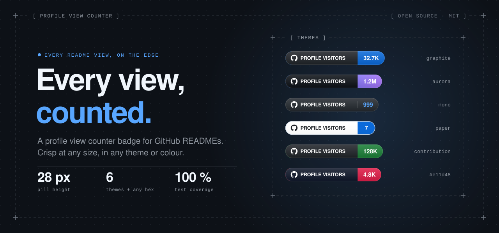
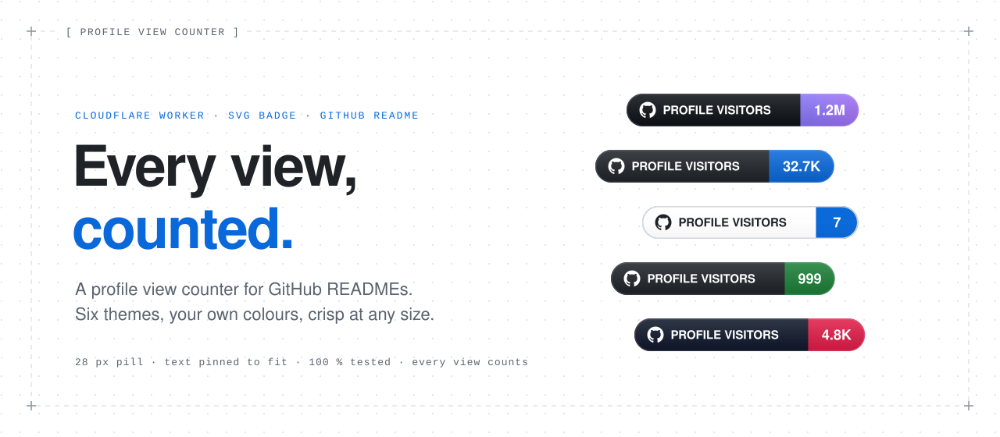
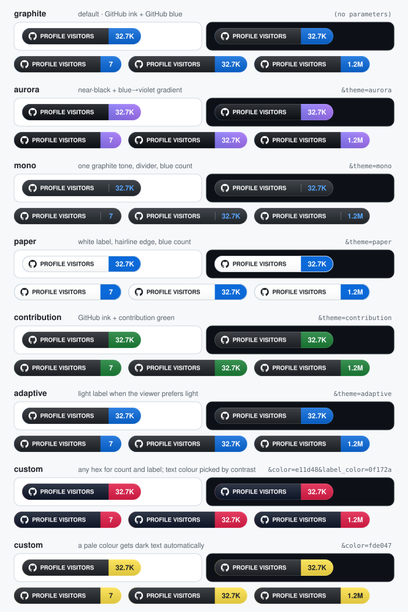
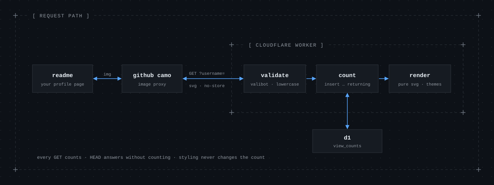

<div align="center">

<a href="https://github.com/tashfiqul-islam/profile-view-counter#gh-dark-mode-only"></a>
<a href="https://github.com/tashfiqul-islam/profile-view-counter#gh-light-mode-only"></a>

### A view counter badge for your GitHub profile, crisp at any size, in any colour

One Cloudflare Worker counts every view of your README, stores it in D1 and draws a 28 px badge
that fits any font. No sign-up, no API key: paste one line.

[](https://github.com/tashfiqul-islam/profile-view-counter/actions/workflows/ci.yml)&nbsp;
[](https://github.com/tashfiqul-islam/profile-view-counter/releases)&nbsp;
[](#development)&nbsp;
[](renovate.json)&nbsp;
[](LICENSE)

**[What you get](#what-you-get) · [Get started](#get-started-in-three-steps) · [Switching](#switching-from-another-counter) · [Themes](#themes-and-colours) · [How it works](#how-it-works) · [API](#api) · [Self-host](#self-host) · [Development](#development) · [Security](.github/SECURITY.md)**

</div>

---

<div align="center">


<sub>What lands on your profile: the default <code>graphite</code> badge. The live one is on <a href="https://github.com/tashfiqul-islam">my profile</a>.</sub>

</div>

## What you get

One line of Markdown, one Worker, one database row per user. Every view counts, the badge is
always current, and bad input fails loudly instead of drawing a wrong number.

<details>
<summary><b>See all features</b></summary>
<br />

<table>
<tr>
<td width="50%" valign="top">

### 📈 Counting

- **Every view**: `Cache-Control: no-store`, so GitHub's image proxy fetches each one
- **Atomic**: one `INSERT … ON CONFLICT DO UPDATE … RETURNING`; concurrent views never race
- **Keep your history**: `&base=` carries views over from any other counter
- **One counter per person**: usernames are case-insensitive; `HEAD` requests count nothing

</td>
<td width="50%" valign="top">

### 🎨 Badge design

- **28 px badge**: corners curved like the GitHub mark, a slanted `/` edge between label and count
- **Always fits**: widths from font metrics, text pinned with `textLength`, centred in any font
- **Readable numbers**: `Intl` compact notation (`999`, `32.7K`, `1.2M`), screen-reader name

</td>
</tr>
<tr>
<td width="50%" valign="top">

### 🌈 Themes and colours

- **Six themes**: `graphite`, `aurora`, `mono`, `paper`, `contribution`, `adaptive`
- **Any hex**: `color` and `label_color` override a theme's backgrounds
- **Contrast-aware**: text picks white or ink by WCAG contrast, so any colour stays legible

</td>
<td width="50%" valign="top">

### 🛡️ Embedding and safety

- **Embeds anywhere**: `Cross-Origin-Resource-Policy: cross-origin` and `Access-Control-Allow-Origin: *`
- **Locked-down SVG**: `Content-Security-Policy: default-src 'none'`, every value XML-escaped
- **Strict input**: Valibot rules return `400 { "error": "…" }` and never count a bad request

</td>
</tr>
<tr>
<td width="50%" valign="top">

### ✅ Quality gate

- **TypeScript 7**: native `tsgo`, strictest flags, type-aware oxlint with zero warnings
- **Real runtime tests**: Vitest inside `workerd` with D1 migrations applied
- **100 % coverage**: Worker and scripts, every metric, enforced in CI

</td>
<td width="50%" valign="top">

### 🚀 Delivery and agents

- **Deploy on merge**: D1 migrations, then `wrangler deploy`, from the merged commit
- **Tag-only releases**: semantic-release from conventional PR titles; labels predict the bump
- **Agent-ready**: `AGENTS.md` routes coding agents to six topic guides

</td>
</tr>
</table>

</details>

## Get started in three steps

```text
+------------------- [ SETUP ] --------------------+
|                                                  |
| 1  Copy the snippet                              |
|    One line of Markdown, below.                  |
| │                                                |
| 2  Put in your username                          |
|    Replace YOUR_USERNAME with your GitHub login. |
| │                                                |
| 3  Paste it into your profile README             |
|    The repository named after your username.     |
|                                                  |
+--------------------------------------------------+
```

```markdown
[](https://github.com/tashfiqul-islam/profile-view-counter)
```

> [!TIP]
> Add `&theme=aurora`, or your own colours with `&color=e11d48&label_color=0f172a`. All options
> are under [Themes and colours](#themes-and-colours).

## Switching from another counter

Already have views on another counter? Add them as `base`, and the badge starts from your real
number instead of zero:

```markdown
[](https://github.com/tashfiqul-islam/profile-view-counter)
```

`base` is added to what the badge shows (0 to 1,000,000,000); new views count on top, and the
stored count stays your real views here. Coming from another GitHub Profile View Counter?
Put its current count in `base` and swap your old badge for this one.

## Themes and colours

Add `&theme=` for a built-in look, or `&color=` / `&label_color=` for your own (6-digit hex, no
`#`). Text switches between white and dark by contrast, so any colour stays readable.

| Parameter     | Values                                                            | Default    |
| ------------- | ----------------------------------------------------------------- | ---------- |
| `theme`       | `graphite`, `aurora`, `mono`, `paper`, `contribution`, `adaptive` | `graphite` |
| `color`       | count background, hex like `0969da`                               | theme's    |
| `label_color` | label background, hex like `1f2328`                               | theme's    |
| `base`        | views carried over from another counter, `0` to `1000000000`      | `0`        |



`adaptive` turns its label light when the viewer's system prefers a light scheme. Styling never
changes the count.

<details>
<summary><b>Copy-ready examples</b></summary>
<br />

```markdown


```

</details>

## How it works

<a href="https://github.com/tashfiqul-islam/profile-view-counter#gh-dark-mode-only"></a>
<a href="https://github.com/tashfiqul-islam/profile-view-counter#gh-light-mode-only"></a>

GitHub serves README images through its image proxy, camo. Each view fetches the badge from the
Worker, which validates the query, counts the view in D1 and renders a fresh SVG. The renderer is a
**pure core**: a count and options in, an SVG string out; the only write is one upsert. Request
flow and module roles in depth: [`src/README.md`](src/README.md).

| Module                       | Role                                                             |
| ---------------------------- | ---------------------------------------------------------------- |
| `src/index.ts`               | Hono app: request id, CORS, security headers, JSON errors        |
| `src/routes/view-counter.ts` | Validate, count, render; `HEAD` returns headers without counting |
| `src/schemas/query.ts`       | Valibot rules for the username, theme and colours                |
| `src/services/counter.ts`    | The atomic D1 upsert, the only write                             |
| `src/badge/generator.ts`     | Pure SVG: layout, themes, contrast, number format                |
| `migrations/`                | D1 schema, applied before every deploy                           |

## Tech stack

<div align="center">

[](https://developers.cloudflare.com/workers/)&nbsp;
[](https://hono.dev)&nbsp;
[](https://valibot.dev)&nbsp;
[](https://www.typescriptlang.org/)&nbsp;
[](https://bun.sh)&nbsp;
[](https://vitest.dev)&nbsp;
[](https://oxc.rs/docs/guide/usage/linter)&nbsp;
[](https://semantic-release.gitbook.io/)

</div>

Hono routes requests on Cloudflare Workers, Valibot validates them and D1 (SQLite at the edge)
holds the counts. Tools are pinned in [`mise.toml`](mise.toml) and git hooks run through
[hk](https://hk.jdx.dev). The badges read `package.json` and `mise.toml` on `main` live, so they
never drift.

## API

```text
+------------------ [ ENDPOINT ] ------------------+
|                                                  |
| GET  /api/view-counter                           |
| Counts one view and returns the badge.           |
|                                                  |
| *  username     string  GitHub login, any case   |
|    theme        string  one of six looks         |
|    color        hex     count background         |
|    label_color  hex     label background         |
|    base         number  views from a previous    |
|                         counter, added on top    |
|                                                  |
| * required                                       |
|                                                  |
+--------------------------------------------------+
```

Bad input returns `400 { "error": "…" }` with the rule that failed, and counts nothing. Full
reference, headers and errors: [`docs/API.md`](docs/API.md).

## Self-host

Run your own copy on the Cloudflare free plan:

```text
+----------------- [ SELF HOST ] ------------------+
|                                                  |
| 1  Install                                       |
|    mise install && mise run setup                |
| │                                                |
| 2  Create the database                           |
|    bunx wrangler d1 create profile-views         |
| │                                                |
| 3  Migrate                                       |
|    bun run db:migrate:prod                       |
| │                                                |
| 4  Deploy                                        |
|    bun run deploy                                |
|                                                  |
+--------------------------------------------------+
```

Merging to `main` then deploys automatically. Step-by-step guide, including the GitHub environment
for the deploy token: [`docs/DEPLOYMENT.md`](docs/DEPLOYMENT.md).

## Development

```sh
mise install && mise run setup        # bun, node, hk and the linters + deps + hooks
bun run check                         # the gate: types · lint · format · docs · tests
bun run db:migrate && bun run dev     # local Worker with D1 emulated
bun run readme:art                    # redraw the README art and the sample badge
```

`bun run check` is the only definition of done: TypeScript 7 (native `tsgo`), type-aware oxlint
with zero warnings, oxfmt, the agent-docs check, Vitest in `workerd` and `bun test` for the
scripts, both at **100 % coverage**. PRs are squash-merged, so the conventional PR title decides
the release: `feat` is a minor version; `fix`, `perf`, `revert`, `security` and dependency updates
a patch. See [CONTRIBUTING](.github/CONTRIBUTING.md) for the full loop and [AGENTS.md](AGENTS.md)
for the conventions coding agents follow.

## License

[MIT](LICENSE) © Tashfiqul Islam

---

<div align="center">
<sub>Made in Dhaka · served from Cloudflare's edge · every view counted</sub>
</div>
