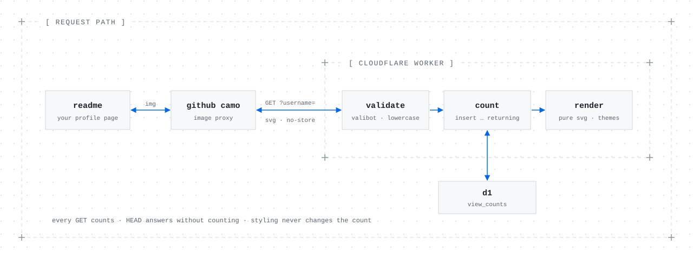

<div align="center">

<picture>
  <source media="(prefers-color-scheme: dark)" srcset="assets/cover-dark.svg" />
  
</picture>

### A view counter badge for your GitHub profile, crisp at any size, in any colour

One Cloudflare Worker counts every view of your README and draws a 28 px badge that fits any font.

[](https://github.com/tashfiqul-islam/profile-view-counter/actions/workflows/ci.yml)&nbsp;
[](https://github.com/tashfiqul-islam/profile-view-counter/releases)&nbsp;
[](#development)&nbsp;
[](renovate.json)&nbsp;
[](LICENSE)

**[Quick start](#quick-start) · [Themes](#themes-and-colours) · [How it works](#how-it-works) · [API](#api) · [Self-host](#self-host) · [Development](#development) · [Security](.github/SECURITY.md)**

</div>

---

## Quick start

Paste this into your profile `README.md` and replace `YOUR_USERNAME`:

```markdown
[](https://github.com/tashfiqul-islam/profile-view-counter)
```

<p align="center"></p>

Every page view counts once, usernames are case-insensitive, and nothing caches the badge, so the
number is always current.

## Themes and colours

Add `&theme=` for a built-in look, or `&color=` / `&label_color=` for your own (6-digit hex, no
`#`). Text switches between white and dark by contrast, so any colour stays readable.

```markdown


```

| Parameter     | Values                                                            | Default    |
| ------------- | ----------------------------------------------------------------- | ---------- |
| `theme`       | `graphite`, `aurora`, `mono`, `paper`, `contribution`, `adaptive` | `graphite` |
| `color`       | count background, hex like `0969da`                               | theme's    |
| `label_color` | label background, hex like `1f2328`                               | theme's    |


`adaptive` turns its label light when the viewer's system prefers a light scheme. Styling never
changes the count.

## How it works

GitHub serves README images through its image proxy, camo. Each view fetches the badge from the
Worker, which validates the query, counts the view in D1 and renders a fresh SVG.

<picture>
  <source media="(prefers-color-scheme: dark)" srcset="assets/architecture-dark.svg" />
  
</picture>

Inside the Worker, one request is four steps:

```
+------------------ [ REQUEST ] -------------------+
|                                                  |
| 1  validate                                      |
|    username, theme and colours; 400 { error }    |
| │                                                |
| 2  count                                         |
|    one atomic upsert in d1; HEAD skips this      |
| │                                                |
| 3  render                                        |
|    pure svg, text pinned to fit, any theme       |
| │                                                |
| 4  respond                                       |
|    image/svg+xml, no-store, so every view counts |
|                                                  |
+--------------------------------------------------+
```

The count is a single `INSERT … ON CONFLICT DO UPDATE … RETURNING`, so concurrent views never race.
Request flow and module roles: [`src/README.md`](src/README.md).

## API

```
+------------------ [ ENDPOINT ] ------------------+
|                                                  |
| GET  /api/view-counter                           |
| Counts one view and returns the badge.           |
|                                                  |
| *  username     string  GitHub login, any case   |
|    theme        string  one of six looks         |
|    color        hex     count background         |
|    label_color  hex     label background         |
|                                                  |
+--------------------------------------------------+
```

Bad input returns `400 { "error": "…" }` with the rule that failed, and counts nothing. Full
reference, headers and errors: [`docs/API.md`](docs/API.md).

## Self-host

Run your own copy on the Cloudflare free plan:

```
+----------------- [ SELF HOST ] ------------------+
|                                                  |
| 1  Install                                       |
|    mise install && mise run setup                |
| │                                                |
| 2  Create the database                           |
|    bunx wrangler d1 create profile-views         |
| │                                                |
| 3  Migrate                                       |
|    bun run db:migrate:prod                       |
| │                                                |
| 4  Deploy                                        |
|    bun run deploy                                |
|                                                  |
+--------------------------------------------------+
```

Merging to `main` then deploys automatically. Step-by-step guide, including the GitHub
environment for the deploy token: [`docs/DEPLOYMENT.md`](docs/DEPLOYMENT.md).

## Development

Every tool version is pinned in `mise.toml`. The gate is the same command locally and in CI, with
100 % coverage enforced on the Worker and on the scripts.

```
+------------------ [ COMMANDS ] ------------------+
|                                                  |
| Setup    mise install && mise run setup          |
| Gate     bun run check                           |
| Dev      bun run db:migrate && bun run dev       |
| Format   bun run format                          |
| Art      bun run readme:art                      |
| Gallery  bun run badge:gallery                   |
|                                                  |
+--------------------------------------------------+
```

```
+------------------- [ LAYOUT ] -------------------+
|                                                  |
| src                                              |
| ├─ index.ts              app, middleware, errors |
| ├─ routes/view-counter   validate, count, render |
| ├─ schemas/query         username and styling    |
| ├─ services/counter      the only write          |
| └─ badge/generator       pure svg and themes     |
| migrations               d1 schema               |
| scripts                  labels, docs, art       |
|                                                  |
+--------------------------------------------------+
```

### Releases

PRs are squash-merged, so the PR title is the commit that decides the release:

```
+------------------ [ PIPELINE ] ------------------+
|                                                  |
| 1  Pull request                                  |
|    title check, release label, quality gate      |
| │                                                |
| 2  Merge to main                                 |
|    squash; the title decides the release         |
| │                                                |
| 3  Deploy                                        |
|    d1 migrations, then wrangler deploy           |
| │                                                |
| 4  Release                                       |
|    tag and GitHub Release with notes             |
|                                                  |
+--------------------------------------------------+
```

`feat` releases a minor version; `fix`, `perf`, `revert`, `security` and dependency updates a
patch. See [CONTRIBUTING](.github/CONTRIBUTING.md) for the full workflow and [AGENTS.md](AGENTS.md)
for the agent guides.

---

<div align="center">

<sub>Built by <a href="https://github.com/tashfiqul-islam">Tashfiqul Islam</a> · <a href="https://x.com/_tashfiqulislam">@_tashfiqulislam</a> · MIT licensed</sub>

</div>
